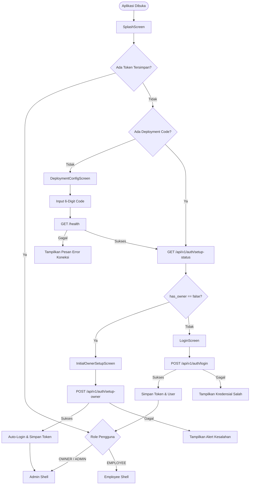

# Manual Test Case & User Journey: HRIS Auth & Setup Lifecycle

Dokumen ini mendefinisikan skenario pengujian manual (manual testing), arsitektur alur pengguna (user journey), dan verifikasi respons endpoint API untuk siklus hidup autentikasi dan inisialisasi sistem KaryaHR.

---

## 1. Pemetaan Endpoint & Peran dalam User Experience (UX)

| Endpoint | Method | Kapan Dipanggil? | Peran dalam UX & Keamanan |
| :--- | :--- | :--- | :--- |
| `/` | `GET` | Handshake opsional / About Screen | Mengetahui versi backend (`1.0.0`) dan status active engine Google Apps Script (GAS). |
| `/health` | `GET` | Saat user klik **Hubungkan Server** di `DeploymentConfigScreen` | Memvalidasi bahwa script Google Spreadsheet aktif dan service lock/cache siap sebelum user masuk. |
| `/api/v1/schemas` | `GET` | Diagnostik admin / Setup Wizard | Memverifikasi kelengkapan 15 skema tabel database HRIS. |
| `/api/v1/admin/init-database` | `POST` | Setup otomatis / Idempotent Guard | Menginisialisasi 15 sheet di Spreadsheet. Dilindungi guard: jika tabel sudah ada, langsung `alreadyInitialized: true` tanpa merusak data. |
| `/api/v1/auth/setup-status` | `GET` | Di `SplashScreen` (jika session kosong) & setelah input deployment | **Traffic Controller**: Penentu mutlak apakah aplikasi membuka layar `InitialOwnerSetupScreen` atau `LoginScreen`. |
| `/api/v1/auth/setup-owner` | `POST` | Di `InitialOwnerSetupScreen` | Hanya dapat dieksekusi 1x saat user kosong. Mengembalikan data akun `OWNER` + JWT token (sehingga user bisa auto-login langsung ke `AdminShell`). |
| `/api/v1/auth/login` | `POST` | Di `LoginScreen` | Autentikasi user terdaftar (Owner/Admin/Employee). Mengembalikan JWT token dan data user untuk routing ke shell yang sesuai. |

---

## 2. Alur User Journey (State Flow Diagram)



---

## 3. Matriks Test Case Manual

### TC-01: First-Time Initialization (Day-0 Setup & Pembuatan Owner)
- **Tujuan**: Memastikan deployment baru yang belum memiliki akun Owner dapat mengarahkan pengguna secara mulus ke `InitialOwnerSetupScreen` dan auto-login ke `AdminShell`.
- **Prekondisi**: Database Spreadsheet baru diinisialisasi, tabel `users` masih kosong (`has_owner = false`).
- **Langkah Pengujian**:
  1. Buka aplikasi pada kondisi fresh install (local storage bersih).
  2. Aplikasi menampilkan `DeploymentConfigScreen`.
  3. Masukkan Deployment ID / Code valid, klik **Hubungkan Server**.
  4. Aplikasi memanggil `GET /health` dilanjutkan `GET /api/v1/auth/setup-status`.
  5. Sistem mendeteksi `has_owner: false`.
  6. Aplikasi otomatis menavigasi ke `InitialOwnerSetupScreen`.
  7. Masukkan Email Owner (contoh: `owner@karyahr.id`), Password (`Password123#`), dan Konfirmasi Password.
  8. Klik **Buat Akun OWNER**.
- **Hasil yang Diharapkan**:
  - Request `POST /api/v1/auth/setup-owner` menghasilkan HTTP 201 dengan payload token dan user data.
  - Token JWT dan data User tersimpan di secure storage.
  - Pengguna langsung diarahkan ke `AdminShell` (Bottom nav / Rail menampilkan tab Admin).

---

### TC-02: Security Guard - Setup Owner Ditolak Saat Owner Sudah Ada
- **Tujuan**: Mencegah celah eskalasi hak akses di mana pihak tidak berwenang mencoba membuat akun Owner tambahan saat sistem sudah berjalan.
- **Prekondisi**: Sistem sudah memiliki setidaknya 1 akun Owner (`has_owner = true`).
- **Langkah Pengujian**:
  1. Buka aplikasi, lakukan input Deployment Code.
  2. Panggil `GET /api/v1/auth/setup-status`.
  3. Coba kirimkan request langsung (atau bypass navigasi) ke `POST /api/v1/auth/setup-owner` dengan payload:
     ```json
     {
       "email": "hacker@test.com",
       "password": "Password123#"
     }
     ```
- **Hasil yang Diharapkan**:
  - Backend menolak request dengan status HTTP 403 / 400: `{"status": 403, "error": {"code": "OWNER_EXISTS", "message": "Akun Owner sudah terdaftar dalam sistem"}}`.
  - Frontend menampilkan notifikasi error dan tidak membuat user baru.
  - Pengguna dialihkan ke `LoginScreen`.

---

### TC-03: Onboarding Karyawan Baru (Login Normal ke Employee Shell)
- **Tujuan**: Memastikan karyawan yang didaftarkan oleh Owner/Admin dapat login dan masuk ke `EmployeeShell`.
- **Prekondisi**: Akun karyawan sudah didaftarkan dengan role `EMPLOYEE`.
- **Langkah Pengujian**:
  1. Buka aplikasi (sudah terhubung server).
  2. Dari `LoginScreen`, masukkan email karyawan (contoh: `budi.santoso@sixbox.com`) dan password valid.
  3. Klik tombol **Masuk**.
  4. Aplikasi mengeksekusi `POST /api/v1/auth/login`.
- **Hasil yang Diharapkan**:
  - Backend merespons status 200 dengan role `EMPLOYEE`.
  - Token dan profil tersimpan di storage.
  - Pengguna dialihkan ke `EmployeeShell` (4 tab: Presensi, Cuti & Izin, Slip Gaji, Profil).

---

### TC-04: Session Persistence & Auto-Login pada SplashScreen
- **Tujuan**: Memverifikasi bahwa pengguna yang sudah login tidak perlu login ulang saat membuka kembali aplikasi.
- **Prekondisi**: Pengguna telah berhasil login sebelumnya dan belum logout.
- **Langkah Pengujian**:
  1. Tutup aplikasi (terminate process).
  2. Buka kembali aplikasi.
  3. Amati transisi dari `SplashScreen`.
- **Hasil yang Diharapkan**:
  - `SplashScreen` membaca token dan profil user dari `AppSecureStorage`.
  - Pengguna langsung dialihkan ke shell yang sesuai (`AdminShell` untuk Owner/Admin, `EmployeeShell` untuk Employee) tanpa menampilkan `DeploymentConfigScreen` atau `LoginScreen`.

---

### TC-05: Idempotency Guard - Inisialisasi Database Ulang
- **Tujuan**: Memverifikasi bahwa pemanggilan `POST /api/v1/admin/init-database` tidak menghapus atau menimpa data sheet yang telah ada.
- **Prekondisi**: Database telah memiliki sheet dan data karyawan.
- **Langkah Pengujian**:
  1. Eksekusi endpoint `POST /api/v1/admin/init-database`.
  2. Periksa response body dan data pada spreadsheet.
- **Hasil yang Diharapkan**:
  - Backend merespons status 200 dengan status `alreadyInitialized: true`.
  - Tidak ada kolom atau data karyawan yang hilang/ter-reset.

---

### TC-06: Validasi Kode Server / Deployment Code Gagal (Health Check Offline)
- **Tujuan**: Memastikan umpan balik yang jelas saat pengguna memasukkan kode deployment yang salah atau server GAS offline.
- **Prekondisi**: Koneksi internet aktif, kode server salah / acak.
- **Langkah Pengujian**:
  1. Buka `DeploymentConfigScreen`.
  2. Masukkan kode 6-digit acak (contoh: `999999`) atau URL yang tidak valid.
  3. Klik **Hubungkan Server**.
- **Hasil yang Diharapkan**:
  - Panggilan `GET /health` gagal (timeout atau 404).
  - Tampil pesan error user-friendly di bawah form (contoh: "Server tidak ditemukan atau URL deployment tidak valid").
  - Pengguna tetap berada di `DeploymentConfigScreen` dan tidak dipaksa lanjut.
